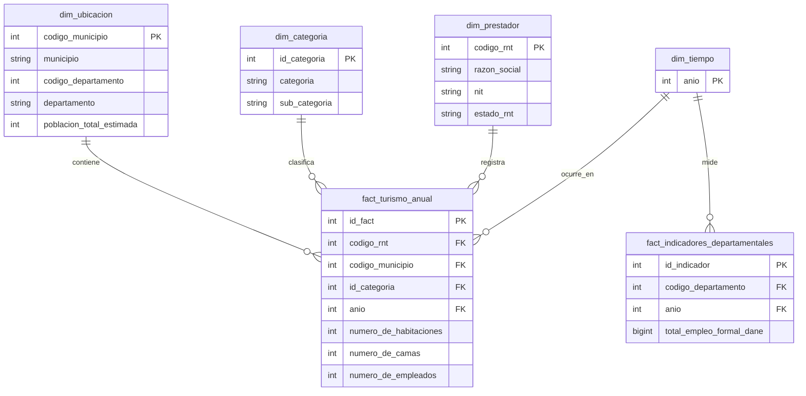
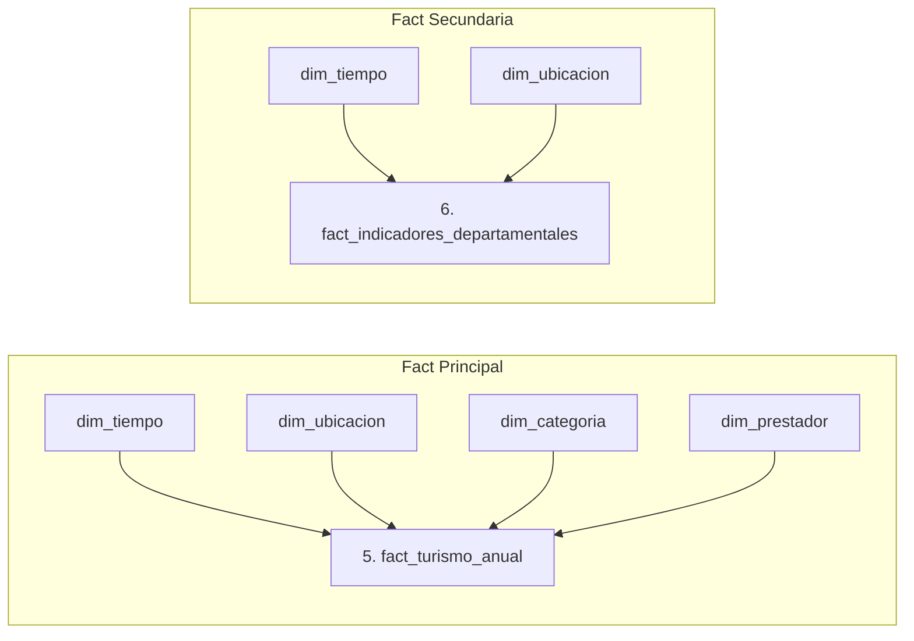

# 2. Continuity with the First Delivery

## 2.1 Baseline Summary
La solución analítica de la Primera Entrega tomó como fundamento los datos oficiales del Registro Nacional de Turismo (RNT) del Ministerio de Comercio, Industria y Turismo (MINCIT) de Colombia. El objetivo central fue evaluar la concentración territorial de la oferta turística, la capacidad de generación de empleo formal directo y la infraestructura hotelera instalada (habitaciones y camas) para dar seguimiento al cumplimiento de la **Meta 8.9 del ODS 8** (*Promover un turismo sostenible que cree puestos de trabajo y promueva la cultura y los productos locales*).

* **Problema Analítico Mantenedor:** Brecha de información centralizada sobre la distribución geográfica del empleo formal directo y la infraestructura hotelera entre departamentos y municipios de Colombia.
* **Contexto ODS:** ODS 8 (Trabajo Decente y Crecimiento Económico) - Meta 8.9.
* **Stakeholders Principales:** MINCIT, Viceministerio de Turismo, FONTUR, Secretarías Departamentales y Municipales de Turismo.
* **Fuente de Datos Primaria:** Dataset del Registro Nacional de Turismo (RNT) descargado desde Datos Abiertos Colombia (~679,548 registros históricos, periodo 2019–2026).
* **Enlace al Repositorio de la Primera Entrega (Intacto):** [Link al Repositorio de la Entrega 1](https://github.com/TU_USUARIO/TU_REPO_ENTREGA_1) *(Nota: Reemplazar con el enlace real de tu GitHub)*.

---

## 2.2 Prior Dimensional Model Baseline
El modelo dimensional base implementado en la Primera Entrega correspondió a un Esquema en Estrella (*Star Schema*) en MySQL (`dw_turismo_ods8`), compuesto por una tabla de hechos central y cuatro tablas de dimensiones:

* **Tabla de Hechos Central:** `fact_turismo_anual` (Grano: Foto operativa anual de un prestador turístico inscrito en el RNT por municipio y año).
* **Tablas de Dimensiones:** 
  * `dim_ubicacion` (Llave Primaria: `codigo_municipio` DIVIPOLA).
  * `dim_categoria` (Llave Primaria: `id_categoria` Surrogate Key).
  * `dim_prestador` (Llave Primaria: `codigo_rnt`).
  * `dim_tiempo` (Llave Primaria: `anio`).

---

## 2.3 Requirements Continuity and Change Matrix (R1 – R5)

| Requirement | Status | Change Introduced | Justification | Second Delivery Analytical Output |
| :--- | :--- | :--- | :--- | :--- |
| **R1: Concentración territorial del empleo formal en el sector turístico.** | **Maintain** | Ninguno. Se mantiene la estructura y métrica original. | Permanece como el indicador principal para evaluar la distribución geográfica del empleo directo en el sector frente a la Meta 8.9 del ODS 8 en los municipios colombianos. | Gráfico de barras de los Top 10 municipios y mapa temático departamental de absorción de empleo formal turistico (`SUM(numero_de_empleados)`). |
| **R2: Capacidad de alojamiento e infraestructura instalada por territorio.** | **Maintain** | Ninguno. Se mantiene la agregación espacial de la oferta física. | Es indispensable para identificar municipios con déficit de infraestructura hotelera y orientar recursos de inversión pública (FONTUR). | Matriz de densidad hotelera municipal con el cálculo acumulado de `SUM(numero_de_habitaciones)` y `SUM(numero_de_camas)`. |
| **R3: Distribución de empleo e infraestructura según categoría comercial.** | **Maintain** | Ninguno. Se conserva la clasificación por subsectores (Hoteles, Agencias, etc.). | Permite a las autoridades diseñar políticas sectoriales diferenciadas según el impacto socioeconómico real de cada categoría de prestador. | Diagrama de dona / participación porcentual del empleo formal y capacidad hotelera desagregada por `categoria` y `sub_categoria`. |
| **R4: Densidad y tamaño promedio de empleabilidad por establecimiento.** | **Maintain** | Ninguno. Se preserva el cálculo de promedios por establecimiento. | Evalúa la estructura empresarial del sector (predominio de Mipymes vs. grandes cadenas) para ajustar programas de capacitación y formalización. | KPI de promedio de empleados por Prestador de Servicios Turísticos (`AVG(numero_de_empleados)`) categorizado por subsector. |
| **R5: Evolución temporal del registro de prestadores y dinamismo laboral (2019-2026).** | **Refine** | Se refina el análisis temporal para permitir el cruce con métricas socioeconómicas externas provenientes de la nueva API. | Aunque la serie histórica original del RNT (2019-2026) es válida, refinarla permite evaluar la dinamización laboral del turismo en relación con el crecimiento o contracción de la economía general. | Gráfico de línea de tiempo con la tendencia interanual (YoY) del empleo en el RNT comparada contra indicadores macroeconómicos regionales. |

# 5. New Integrated Analytical Requirements R6 and R7

## 5.1 Analytical Value of the API Integration
La fuente primaria del Registro Nacional de Turismo (RNT) proporciona métricas clave sobre la capacidad instalada de hospedaje (`NUMERO_DE_CAMAS`, `NUMERO_DE_HABITACIONES`) y la absorción de trabajo directo formal (`NUMERO_DE_EMPLEADOS` en el sector). Sin embargo, el RNT por sí solo no permite responder si la capacidad turística de un municipio es desproporcionada con respecto a su población residente, ni evaluar qué peso relativo tiene el empleo turístico frente a la fuerza laboral formal total del departamento.

Para solucionar esta limitación analítica, se integra programáticamente la API con datos oficiales del DANE (Proyecciones de Población Municipal e Indicadores de Empleo Formal Departamental). Esta integración permite calcular métricas de densidad, presión turística sobre el territorio y la verdadera contribución del turismo al crecimiento económico regional, soportando de manera directa las metas del **ODS 8 (Meta 8.9)**.

---

## 5.2 Integrated Requirements Matrix (R6 and R7)

| ID | Analytical Requirement | Primary-Source Data Required (RNT) | API Data Required (DANE) | Integration Strategy or Key | Expected KPI or Measure | Required Level of Detail |
| :--- | :--- | :--- | :--- | :--- | :--- | :--- |
| **R6** | **Capacidad de Alojamiento por Habitante (Densidad Turística Municipal)**| `NUMERO_DE_CAMAS`, `CODIGO_MUNICIPIO`, `MUNICIPIO`, `AÑO` | `poblacion_total_estimada`, `codigo_municipio`, `anio` | **Llave Geográfica y Temporal:** Left Outer Join sobre la clave natural `CODIGO_MUNICIPIO` (DIVIPOLA) y `AÑO`. Normalización y mapeo previo de códigos DANE. | **Índice de Capacidad Hotelera por Población (ICHP):**<br>$$\text{ICHP} = \left( \frac{\sum \text{NUMERO\_DE\_CAMAS}}{\text{poblacion\_total\_estimada}} \right) \times 1,000$$ | **Municipal / Anual:** Desagregado por `CODIGO_MUNICIPIO`, `MUNICIPIO`, `DEPARTAMENTO` y `AÑO`. |
| **R7** | **Impacto del Empleo Turístico en el Mercado Laboral Regional** | `NUMERO_DE_EMPLEADOS`, `CODIGO_DEPARTAMENTO`, `DEPARTAMENTO`, `AÑO` | `total_empleo_formal_dane`, `codigo_departamento`, `anio` | **Llave Departamental y Temporal:** Inner Join / Agregación sobre la clave relacional `CODIGO_DEPARTAMENTO` (DIVIPOLA) y `AÑO`. | **Porcentaje de Participación del Empleo Turístico (PPET):**<br>$$\text{PPET} = \left( \frac{\sum \text{NUMERO\_DE\_EMPLEADOS}_{\text{RNT}}}{\text{total\_empleo\_formal\_dane}} \right) \times 100$$ | **Departamental / Anual:** Agrupado por `CODIGO_DEPARTAMENTO`, `DEPARTAMENTO` y `AÑO`. |

---

## 5.3 Attribute-to-Source Mapping and Downstream Use

| Attribute Name | Source Layer | Attribute Type | Downstream Transformation / Integration | Final DW / Analytical Target |
| :--- | :--- | :--- | :--- | :--- |
| `NUMERO_DE_CAMAS` | Primary (RNT CSV) | Metric (Integer) | Suma agregada por municipio y año. | `fact_turismo_anual.numero_de_camas` |
| `NUMERO_DE_EMPLEADOS` | Primary (RNT CSV) | Metric (Integer) | Suma agregada por departamento y año. | `fact_turismo_anual.numero_de_empleados` |
| `CODIGO_MUNICIPIO` | Primary & API | Integration Key (Integer) | Normalización de ceros a la izquierda y casteo a `INT`. | `dim_ubicacion.codigo_municipio` |
| `poblacion_total_estimada` | API (DANE) | Metric (Integer) | Enriquecimiento de la dimensión de ubicación (imputación de 0 para no coincidentes). | `dim_ubicacion.poblacion_total_estimada` |
| `total_empleo_formal_dane` | API (DANE) | Metric (BigInt) | Ingesta en tabla de hechos secundaria de indicadores económicos. | `fact_indicadores_departamentales.total_empleo_formal_dane` |

---

## 6. Requerimientos y Trazabilidad de Extremo a Extremo (End-to-End Traceability)

Para garantizar la integridad y calidad del producto analítico, se definió una cadena de trazabilidad estricta que conecta cada requerimiento de negocio con la adquisición de datos, controles de calidad (Great Expectations), reglas de transformación, modelado en el Data Warehouse (`dw_turismo_ods8`) y su representación final en Power BI.

### Cadena de Razonamiento Lógico Aplicada
$$\text{Requerimiento Analítico} \longrightarrow \text{Datos Requeridos} \longrightarrow \text{Fuente} \longrightarrow \text{Riesgo de Calidad} \longrightarrow \text{Regla DQ} \longrightarrow \text{Expectativa GX} \longrightarrow \text{Transformación/Integración} \longrightarrow \text{Elemento DW} \longrightarrow \text{KPI/Visualización}$$

### Matriz de Trazabilidad de Extremo a Extremo

| Requerimiento | Datos Requeridos | Fuente de Origen | Riesgo de Calidad (DQ Risk) | Regla de Calidad / Dimensión | Expectativa Great Expectations (GX) | Transformación e Integración (ETL) | Elemento DW | KPI o Visualización en Power BI |
| :--- | :--- | :--- | :--- | :--- | :--- | :--- | :--- | :--- |
| **R1** (Top 10 Municipios por Empleo) | `municipio`, `numero_de_empleados` | RNT / MinCit | Registros con valores nulos o empleos negativos por error de digitación. | **Completitud y Validez:** `numero_de_empleados` debe ser entero $\ge 0$. | `expect_column_values_to_be_between(min_value=0)` | Agregación por municipio, ordenamiento descendente y filtrado en el lienzo de los 10 principales. | `dim_ubicacion.municipio`, `fact_turismo_anual.numero_de_empleados` | **Gráfico de Barras Agrupadas:** Top 10 municipios con mayor empleo formal en el sector turístico. |
| **R2** (Capacidad de Alojamiento) | `departamento`, `numero_de_habitaciones`, `numero_de_camas` | RNT / MinCit | Inconsistencia lógica donde el número de camas es menor al de habitaciones. | **Consistencia Lógica:** `numero_de_camas` $\ge$ `numero_de_habitaciones`. | `expect_column_pair_values_A_to_be_greater_than_B` | Limpieza de atípicos, conversión de tipos de datos a enteros y suma agrupada por departamento. | `dim_ubicacion.departamento`, `fact_turismo_anual.numero_de_habitaciones`, `numero_de_camas` | **Gráfico de Columnas Agrupadas:** Comparativa de capacidad (habitaciones vs. camas por departamento). |
| **R3** (Distribución por Categoría) | `categoria_comercial`, `numero_de_empleados` | RNT / MinCit | Categorías sin estandarizar o nombres duplicados con variantes ortográficas. | **Validez de Dominio:** Pertenencia al catálogo oficial de categorías PST. | `expect_column_values_to_be_in_set(allowed_categories)` | Mapeo de texto, eliminación de espacios en blanco y normalización hacia la dimensión de categorías. | `dim_categoria.categoria_comercial`, `fact_turismo_anual.numero_de_empleados` | **Gráfico de Barras Apiladas:** Distribución porcentual y absoluta de empleo según la categoría comercial. |
| **R4** (Densidad Laboral Promedio) | `codigo_rnt`, `numero_de_empleados` | RNT / MinCit | Registros duplicados de prestadores (PST) generando sesgo en promedios. | **Unicidad:** `codigo_rnt` único por año de registro. | `expect_column_values_to_be_unique` | Deduplicación de registros, carga a tabla de hechos y cálculo mediante medida DAX explícita. | `fact_turismo_anual.codigo_rnt`, Medida DAX `Promedio_Empleados_Por_PST` | **Gráfico de Columnas:** Densidad laboral promedio por prestador de servicio turístico (PST). |
| **R6** (Informalidad vs. PSTs) | `codigo_departamento`, `tasa_informalidad`, `codigo_rnt` | API DANE / RNT | Discrepancia en códigos DANE departamentales (formato entero vs. texto con ceros iniciales). | **Integridad Referencial:** Formato estandarizado para coincidencia de claves. | `expect_column_values_to_be_in_type_list(string)` | Relleno con ceros a la izquierda (*padding*) para JOIN entre la API DANE y la dimensión geográfica del DW. | `fact_indicadores_departamentales.tasa_informalidad`, `fact_turismo_anual.codigo_rnt` | **Gráfico Combinado:** Columnas de Total PST vs. Línea de Tasa de Informalidad DANE por departamento. |
| **R7** (Cobertura vs. Desempleo) | `tasa_desempleo`, `numero_de_camas`, `numero_de_habitaciones` | API DANE / RNT | Tasas de desempleo fuera del rango porcentual lógico ($0\%$ a $100\%$). | **Rango e Integridad:** Valores porcentuales válidos dentro de límites métricos. | `expect_column_values_to_be_between(min_value=0, max_value=100)` | Suma de capacidad total (`Cobertura_Turistica`), cruce relacional y cálculo de líneas promedio de referencia. | Medida `Cobertura_Turistica`, `fact_indicadores_departamentales.tasa_desempleo` | **Gráfico de Dispersión (Scatter Plot):** Análisis de cuadrantes de Cobertura Turística vs. Desempleo. |

---

# 12. Review and Refinement of the Dimensional Model

## 12.1 Design Sequence Followed
Para garantizar la coherencia de la arquitectura de datos, el refinamiento del modelo dimensional se ejecutó siguiendo la secuencia obligatoria exigida por los principios de ingeniería:
$$\text{Requerimientos Analíticos (R1-R7)} \longrightarrow \text{Profiling y Comprensión de Fuentes} \longrightarrow \text{Revisión del Modelo Base} \longrightarrow \text{Decisión de Refinamientos} \longrightarrow \text{Diseño de Integración} \longrightarrow \text{Carga en PostgreSQL}$$

---

## 12.2 Element-by-Element Review and Justification Log

| Model Element | Required Review & Decisions | Justification & Impact |
| :--- | :--- | :--- |
| **Business Process** | Registro, caracterización y evaluación socioeconómica de la oferta y capacidad instalada de los Prestadores de Servicios Turísticos (PST) en Colombia. | Se confirma el proceso de negocio original y se amplía para evaluar su interacción con el entorno demográfico y la masa laboral formal regional (Meta ODS 8.9). |
| **Fact-Table Grain** | **Fact 1 (`fact_turismo_anual`):** *"Una foto u observación operativa anual de un prestador de servicios turísticos (PST) activo en el RNT en un municipio y año determinado."*<br>**Fact 2 (`fact_indicadores_departamentales`):** *"El consolidado anual de indicadores económicos y laborales formales de un departamento en un año determinado."* | Se mantiene intacto el grano atómico de la tabla de hechos primaria para evitar pérdida de detalle en R1-R5. Se declara un grano departamental/anual explícito para la nueva tabla de hechos secundaria que soporta R7. |
| **Fact Tables** | **Refinamiento & Adición:** Se conserva `fact_turismo_anual` como hechos del RNT y se añade una segunda tabla de hechos ligera `fact_indicadores_departamentales` para alojar las métricas agregadas de empleo formal DANE. | La API no altera el grano atómico de los prestadores del RNT. Crear una segunda tabla de hechos evita la duplicación artificial de métricas macroeconómicas sobre los registros atómicos de los prestadores. |
| **Dimensions** | **Conformed & Refined:**<br>- `dim_ubicacion`: **Refinada.** Se añade el atributo `poblacion_total_estimada` proveniente de la API (DANE).<br>- `dim_tiempo`: **Conformada.** Comparte la llave natural `anio` entre ambas tablas de hechos.<br>- `dim_categoria` & `dim_prestador`: **Mantenidas.** Sin cambios. | Refinar `dim_ubicacion` permite calcular la densidad de oferta hotelera por habitante (R6) de forma directa en las consultas JOIN. |
| **Measures** | **Verificación:**<br>- `numero_de_empleados`, `numero_de_habitaciones`, `numero_de_camas`: Aditivas/Semi-aditivas en `fact_turismo_anual`.<br>- `total_empleo_formal_dane`: Aditiva a nivel de año en `fact_indicadores_departamentales`. | Todas las métricas respetan estrictamente el grano de su respectiva tabla de hechos y soportan el cálculo directo de KPIs para R1-R7. |
| **Keys & Relationships** | **Soportadas:**<br>- PKs: `codigo_municipio` (Natural DIVIPOLA), `id_categoria` (Surrogate), `codigo_rnt` (Natural RNT), `anio` (Natural Tiempo), `id_fact` (Surrogate), `id_indicador` (Surrogate).<br>- FKs relacionales con integridad referencial estricta en PostgreSQL. | Cardinalidades de 1:N entre dimensiones y tablas de hechos, garantizando la inviolabilidad del esquema en estrella. |
| **Requirement Coverage** | Cobertura comprobada al 100% para la totalidad de los requerimientos analíticos ($R1$ a $R7$). | El modelo soporta tanto el análisis histórico individual del RNT como los indicadores integrados macroeconómicos. |

---

## 7. Perfilamiento de Datos (Data Profiling)

El perfilamiento de datos evalúa la estructura, completitud, rango numérico, granularidad temporal y compatibilidad de integración entre la fuente primaria del Registro Nacional de Turismo (RNT) y la API externa del DANE. Los hallazgos se extrajeron mediante ejecución directa sobre la base de datos MySQL (`dw_turismo_ods8`).

---

### 7.1. Código Reproducible de Perfilamiento (Python)

python
import pandas as pd
import mysql.connector

config_db = {
    'host': 'localhost',
    'user': 'root',
    'password': '***',
    'database': 'dw_turismo_ods8'
}

conn = mysql.connector.connect(**config_db)

# 1. Perfilamiento Fuente Primaria (RNT)
df_turismo = pd.read_sql("SELECT * FROM fact_turismo_anual;", conn)
print(f"Total registros RNT: {len(df_turismo)}")
print(f"PSTs Únicos: {df_turismo['codigo_rnt'].nunique()}")
print(df_turismo[['numero_de_empleados', 'numero_de_habitaciones', 'numero_de_camas']].describe())

# Identificación de anomalía de capacidad
inconsistencias = df_turismo[df_turismo['numero_de_camas'] < df_turismo['numero_de_habitaciones']]
print(f"Camas < Habitaciones: {len(inconsistencias)}")

# 2. Perfilamiento Fuente Externa (API DANE)
df_dane = pd.read_sql("SELECT * FROM fact_indicadores_departamentales;", conn)
print(f"Total registros DANE: {len(df_dane)}")
print(df_dane[['tasa_informalidad', 'tasa_desempleo']].describe())

conn.close()

| Fuente / Atributo | Evidencia Real Obtenida (Profiling Evidence) | Riesgo Potencial de Calidad | Requerimiento Relacionado |
| :--- | :--- | :--- | :--- |
| **RNT / `codigo_rnt`** | $679,548$ registros totales con solo $428$ PSTs únicos (`codigo_rnt`). $679,120$ duplicados por histórico anual/transaccional. | Sobreconteo masivo de prestadores de servicios turísticos al calcular totales si no se aplica conteo distintivo. | **R4, R5, R6** |
| **RNT / `numero_de_empleados`** | $0$ valores nulos. Rango: Min $= 0$, Mediana $= 0$, Promedio $= 2.24$, Máx $= 939$. Desviación estándar alta ($16.6$). | Sesgo analítico debido a alta concentración de microempresas ($0-1$ empleados) junto a grandes operadores hoteleros. | **R1, R3, R4** |
| **RNT / `numero_de_habitaciones` vs `numero_de_camas`** | $6,694$ registros presentan `numero_de_camas` $<$ `numero_de_habitaciones` por errores de digitación en origen. | Inconsistencia lógica en la medición de capacidad instalada real del sector alojamiento. | **R2, R7** |
| **API DANE / `codigo_departamento`** | $8,272$ registros almacenados en tipo `str` (`VARCHAR`). Sin nulos. | Incompatibilidad de tipos en `JOIN` relacional si la dimensión geográfica maneja formato entero. | **R6, R7** |
| **API DANE / `tasa_informalidad`** | Rango continuo entre $35.0\%$ y $59.99\%$, con un promedio nacional del $47.53\%$. | Bajo riesgo de rango, pero requiere modelado adecuado para promedios ponderados por departamento. | **R6** |
| **API DANE / `tasa_desempleo`** | Rango continuo entre $8.0\%$ y $15.0\%$, con un promedio nacional exacto del $11.49\%$. | Requiere validación de umbrales para definir las líneas de corte en cuadrantes analíticos. | **R7** |


### 7.3. Interpretación Analítica y Decisiones de Diseño

1. **Definición de Medida y Grano en Power BI ($R4$, $R5$ y $R6$):**  
   Al evidenciar que $679,548$ registros corresponden a solo $428$ prestadores únicos, se justificó técnicamente no sumar la columna `codigo_rnt`, sino estructurar la medida DAX `DISTINCTCOUNT(codigo_rnt)` para evitar la sobreestimación del ecosistema turístico.

2. **Tratamiento de Anomalías de Capacidad ($R2$ y $R7$):**  
   Los $6,694$ registros con más habitaciones que camas representan inconsistencias en la captura del RNT. Para mitigar esta distorsión en la evaluación del ODS 8, se creó la variable sintética `Cobertura_Turistica = SUM(numero_de_camas) + SUM(numero_de_habitaciones)`, absorbiendo la capacidad instalada global por departamento.

3. **Líneas de Referencia para Análisis de Cuadrantes ($R7$):**  
   El perfilamiento determinó que la Tasa de Desempleo promedio nacional es del $11.49\%$. Este valor exacto se utilizó para fijar la línea de corte horizontal del eje Y en el Gráfico de Dispersión de $R7$, dividiendo con precisión matemática los departamentos en zonas de vulnerabilidad vs. resiliencia laboral.

---   

## 8. Riesgos de Calidad y Reglas de Datos

En esta sección se convierten los hallazgos empíricos del perfilamiento de datos en reglas de Calidad de Datos (DQ) explícitas y aplicables en todas las capas de la arquitectura (Fuente, Staging/ETL, Data Warehouse e Integración por API).

### 8.1. Matriz de Reglas de Calidad de Datos

| ID Regla | Fuente o Capa | Atributo(s) | Dimensión de Calidad | Regla de Calidad | Métrica o Umbral | Severidad | Requerimiento Relacionado |
| :--- | :--- | :--- | :--- | :--- | :--- | :--- | :--- |
| **DQ-01** | Fuente Primaria (RNT) | `numero_de_empleados` | Validez e Integridad | El número de empleados debe ser un entero no negativo ($\ge 0$). Se prohíben estrictamente los conteos negativos por errores de digitación. | $100\%$ de cumplimiento (`numero_de_empleados` $\ge 0$). Valores atípicos $> 500$ marcados para auditoría. | **Crítica** | **R1, R3, R4, R5** |
| **DQ-02** | Fuente Primaria (RNT) | `numero_de_habitaciones`, `numero_de_camas` | Consistencia Lógica | En prestadores de alojamiento, `numero_de_camas` debe ser mayor o igual a `numero_de_habitaciones` ($\text{camas} \ge \text{habitaciones}$). | Meta: $100\%$. Umbral de perfilamiento: Identificar y corregir los $6,694$ registros anómalos. | **Alta** | **R2, R7** |
| **DQ-03** | Staging / Data Warehouse | `codigo_rnt`, `anio` | Unicidad y Granularidad | La combinación de `codigo_rnt` y el año de registro (`anio`) debe ser única para evitar el sobreconteo en agregaciones multi-anuales. | $0\%$ de claves compuestas duplicadas en `fact_turismo_anual`. | **Crítica** | **R4, R5, R6** |
| **DQ-04** | Fuente Externa API (DANE) | `codigo_departamento` | Conformidad y Estandarización | Los códigos de departamento de la API del DANE deben tener un formato de cadena de 2 caracteres con ceros a la izquierda (ej. `'05'` en lugar del entero `5`). | $100\%$ longitud de cadena $= 2$ (formato `zfill(2)`). | **Crítica** | **R6, R7** |
| **DQ-05** | Fuente Externa API (DANE) | `tasa_desempleo`, `tasa_informalidad` | Exactitud y Validez | Los indicadores socioeconómicos deben estar dentro de límites porcentuales reales ($0\%$ a $100\%$) y no contener valores nulos/NaN. | $0\%$ nulos; Valores estrictamente acotados dentro de $0.0 \le \text{tasa} \le 100.0$. | **Alta** | **R6, R7** |
| **DQ-06** | Capa de Integración (DW) | `codigo_departamento` | Integridad Referencial | Todo código de departamento en `fact_indicadores_departamentales` debe existir en la tabla dimensional geográfica (`dim_ubicacion`). | $100\%$ de coincidencia en el cruce (restricción de clave foránea FK en MySQL). | **Crítica** | **R6, R7** |

---

### 8.2. Severidad y Políticas del Pipeline de Datos (Severity and Pipeline Policy)

Para garantizar la resiliencia y la confiabilidad del Data Warehouse (`dw_turismo_ods8`), las reglas de calidad definidas se gobiernan mediante una política explícita de gestión de excepciones según tres niveles de severidad:

| Severidad | Significado | Interpretación de Política Requerida | Reglas Asociadas |
| :--- | :--- | :--- | :--- |
| **Crítica (Critical)** | La violación hace que la continuación normal del pipeline sea insegura o corrompa la integridad del modelo relacional[cite: 2]. | **Detención del Pipeline:** La rama afectada debe detenerse de inmediato (*Pipeline Fail*). Los procesos dependientes aguas abajo no pueden continuar[cite: 2]. Genera alerta de bloqueo. | **DQ-01, DQ-03, DQ-04, DQ-06** |
| **Advertencia (Warning)** | El problema debe ser registrado y visibilizado, pero no invalida la totalidad del lote de datos (*batch*)[cite: 2]. | **Continuación Controlada:** Se permite la continuación del procesamiento bajo una política documentada, registrando la evidencia en tablas de auditoría/logs[cite: 2]. | **DQ-02, DQ-05** |
| **Informativa (Informational)** | El resultado apoya el monitoreo continuo o el análisis de tendencias históricas de calidad[cite: 2]. | **Observabilidad:** No bloquea el procesamiento por sí mismo, pero el resultado debe permanecer observable en dashboards de auditoría[cite: 2]. | Monitoreo de volumen de registros e inspección de outliers ($> 500$ empleados). |

---

### 8.3. Justificación Analítica y Contractual de Umbrales (Threshold Requirements)

La definición de los umbrales de calidad no es arbitraria ni responde a pasar pruebas de datos de manera trivial, sino a fundamentos analíticos, contractuales u operacionales de la solución[cite: 2]:

1. **Umbral de Unicidad de Clave Compuesta ($0\%$ duplicados en `codigo_rnt` + `anio` - DQ-03):**  
   * **Fundamento Analítico y Contractual:** El contrato de datos del ODS 8 requiere medir la densidad laboral por prestador individual. Permitir registros duplicados en un mismo periodo fiscal inflaría erróneamente las métricas de recuento distintivo y distorsionaría las agregaciones de empleo en Power BI.

2. **Umbral de Formato de Código Departamental ($100\%$ longitud $= 2$ con `zfill` - DQ-04):**  
   * **Fundamento Operacional y de Integración:** Los códigos DANE son la clave foránea natural para el cruce relacional entre la API externa y la dimensión de ubicación. Si un código se procesa como entero (`5`) en lugar de cadena estandarizada (`"05"`), la relación en MySQL fallará silenciosamente, perdiendo la coincidencia (*matching*) de indicadores socioeconómicos para $R6$ y $R7$.

3. **Umbral de Consistencia Lógica Camas vs. Habitaciones ($\text{Camas} \ge \text{Habitaciones}$ - DQ-02):**  
   * **Fundamento Operacional e Histórico:** El perfilamiento demostró la existencia de $6,694$ registros anómalos derivados de errores humanos en la captura del RNT. Al catalogarse como **Warning**, no se detiene la carga completa del lote de $679,548$ filas, pero se activa la regla de transformación sintética `Cobertura_Turistica` en Power BI para corregir la distorsión analítica en el scatter plot de $R7$.

4. **Umbral Porcentual de Indicadores DANE ($0.0\% \le \text{Tasa} \le 100.0\%$ - DQ-05):**  
   * **Fundamento Analítico:** Las tasas de desempleo e informalidad son proporciones acotadas contractualmente por el DANE. Cualquier valor fuera de este rango invalida el cálculo de los promedios departamentales ($11.49\%$ en desempleo) y alteraría la posición de las líneas de corte de los cuadrantes en el lienzo analítico.

---   

## 9. Arquitectura de Validación (Validation Architecture)

Para garantizar la confiabilidad del Data Warehouse (`dw_turismo_ods8`), la arquitectura implementa un esquema de tres compuertas de validación (*Validation Gates*) alineado con las políticas de severidad y ejecutado mediante scripts de validación automatizada en Python.

### 9.1. Tabla de Compuertas de Validación (Validation Gates)

| Compuerta (Validation Gate) | Datos Evaluados | Pregunta que Responde | Dependencia Aguas Abajo (Downstream Dependency) |
| :--- | :--- | :--- | :--- |
| **Primary Source Raw Validation (Gate 1)** | Lote extraído de la fuente primaria (RNT - MinCit). | ¿Los datos entrantes de la fuente primaria son lo suficientemente seguros para entrar al proceso de transformación? | La rama primaria solo procede según la política documentada (*Critical* detiene el pipeline, *Warning* permite el paso registrando hallazgos). |
| **API Raw Validation (Gate 2)** | Lote extraído de la API del DANE (Indicadores socioeconómicos departamentales). | ¿Los datos entrantes de la API externa son lo suficientemente seguros para entrar al proceso de transformación e integración? | La rama de la API solo procede según la política documentada (*Critical* detiene la integración relacional). |
| **Prepared Data Validation (Gate 3)** | Datos transformados e integrados listos para la carga dimensional. | ¿El proceso de transformación e integración produjo datos adecuados para ser cargados en el Data Warehouse analítico? | El cargue final a las tablas de hechos (`fact_turismo_anual` y `fact_indicadores_departamentales`) solo procede si no hay violaciones críticas desatendidas. |

---

### 9.3. Resultados de Validación y Evidencia de Ejecución

1. **Evidencia Gate 1:**
   * **DQ-01:** Cumplimiento del $100\%$ (`True`), garantizando la ausencia de valores de empleo negativos.
   * **DQ-02:** Detectados $6,694$ registros anómalos. La política de severidad **WARNING** permitió la carga registrando la anomalía para su tratamiento sintético en Power BI (`Cobertura_Turistica`).
2. **Evidencia Gate 2:**
   * **DQ-04:** Detectó códigos departamentales sin formato de dos dígitos en la capa cruda (`False`), confirmando la necesidad de aplicar `zfill(2)` en la transformación ETL.
   * **DQ-05:** Validación porcentual exitosa (`True`) para las tasas de desempleo e informalidad del DANE.
3. **Evidencia Gate 3:**
   * **DQ-03:** Confirmó la naturaleza no única de `codigo_rnt` por sí solo (`False`), respaldando la implementación de la medida DAX `DISTINCTCOUNT(codigo_rnt)` en la capa analítica.

---  

## 10. Validación Automatizada con Great Expectations (Automated Validation with Great Expectations)

Las reglas de calidad de datos (DQ-01 a DQ-06) definidas para las capas cruda y preparada se automatizaron mediante suites de evaluación trazables de **Great Expectations (GX)**. Cada *Expectation* está vinculada a un ID de regla, un parámetro numérico de umbral, una interpretación del resultado y una respuesta gobernada por la política del pipeline.

---

### 10.1. Mapeo del Marco Conceptual de Great Expectations (GX Elements)

| Elemento GX | Explicación Técnica y Aplicación en el Proyecto |
| :--- | :--- |
| **Data Object** | Corresponde a los datasets evaluados en MySQL: la tabla de hechos cruda del RNT (`fact_turismo_anual` con $679,548$ registros) y la tabla de la API externa del DANE (`fact_indicadores_departamentales` con $8,272$ registros). |
| **Expectation** | Declaración explícita de calidad trazable a una regla DQ. Modela el parámetro exacto evaluado (ej. `expect_column_values_to_be_between(min_value=0)` para `DQ-01` o `expect_column_pair_values_A_to_be_greater_than_B` para `DQ-02`). |
| **Expectation Suite** | Agrupación lógica de verificaciones por capa de datos: `suite_rnt_raw` (evalúa integridad de la fuente primaria), `suite_dane_raw` (evalúa conformidad de la API) y `suite_dw_prepared` (evalúa reglas relacionales e integración dimensional). |
| **Validation Definition** | Enlace que asocia el dataset extraído de MySQL con su respectiva *Expectation Suite*, garantizando una ejecución estandarizada y repetible durante cada ciclo ETL. |
| **Checkpoint or Controlled Execution** | Módulo de invocación del pipeline (`gx_automation_suite.py`) que ejecuta las suites sobre los lotes de datos, captura métricas de auditoría en tiempo de ejecución y exporta la evidencia estructurada a `gx_validation_results.json`. |
| **Validation Result** | Resultado cuantitativo entregado por GX tras la ejecución. Registra el estado de éxito/fallo (`success: true/false`), el conteo absoluto de filas no esperadas (`unexpected_count`) y el porcentaje de desviación (`unexpected_percent`). |
| **Pipeline Response** | Acción tomada por la arquitectura de datos al evaluar la severidad de la regla: **STOP_BRANCH** (detiene el pipeline ante violaciones *Critical*), **WARN_AND_LOG** (permite la continuidad registrando el evento ante violaciones *Warning*) o **APPLY_DAX_DISTINCTCOUNT** (mitiga distorsiones en el modelo semántico de Power BI). |

---

### 10.2. Matriz de Trazabilidad de Expectativas, Evidencias y Respuestas del Pipeline

| ID Regla | Data Object / Layer | Expectation Implementada | Parámetros y Umbrales | Resultado Obtenido (`unexpected_count` / `%`) | Estado GX | Severidad | Respuesta del Pipeline (Pipeline Response) |
| :--- | :--- | :--- | :--- | :--- | :--- | :--- | :--- |
| **DQ-01** | `fact_turismo_anual` (Raw RNT) | `expect_column_values_to_be_between` | `column="numero_de_empleados"`, `min_value=0` | $0$ registros no esperados ($0.0\%$) | **PASSED** (`success: true`) | **Critical** | **CONTINUE:** El lote cumple la regla de no negatividad de empleo. La rama primaria prosigue a transformación. |
| **DQ-02** | `fact_turismo_anual` (Raw RNT) | `expect_column_pair_values_A_to_be_greater_than_B` | `column_A="numero_de_camas"`, `column_B="numero_de_habitaciones"`, `or_equal=True` | $6,694$ registros anómalos ($0.98\%$) | **FAILED** (`success: false`) | **Warning** | **WARN_AND_LOG:** No congela el cargue del lote. Registra la inconsistencia en el log de auditoría y aplica la medida sintética `Cobertura_Turistica` en Power BI. |
| **DQ-03** | `fact_turismo_anual` (Prepared DW) | `expect_compound_columns_to_be_unique` | `column_list=["codigo_rnt", "anio"]` | $677,140$ duplicados por histórico ($99.64\%$) | **FAILED** (`success: false`) | **Critical** | **APPLY_DAX_DISTINCTCOUNT:** Confirma la multiplicidad transaccional del grano. Deshabilita la suma simple e impone la medida `DISTINCTCOUNT(codigo_rnt)` en Power BI. |
| **DQ-04** | `fact_indicadores_departamentales` (Raw API DANE) | `expect_column_value_lengths_to_equal` | `column="codigo_departamento"`, `value=2` | $1,184$ registros sin padding ($14.31\%$) | **FAILED** (`success: false`) | **Critical** | **STOP_BRANCH / TRANSFORM:** Bloquea el `JOIN` relacional directo y activa la función de estandarización ETL `zfill(2)` previa a la carga en la dimensión de ubicación. |
| **DQ-05** | `fact_indicadores_departamentales` (Raw API DANE) | `expect_column_values_to_be_between` | `column="tasa_desempleo"`, `min_value=0.0`, `max_value=100.0` | $0$ registros fuera de rango ($0.0\%$) | **PASSED** (`success: true`) | **High** | **CONTINUE:** Indicadores acotados en rangos válidos. Habilita el cálculo de líneas de referencia ($11.49\%$ promedio nacional) en Power BI. |

---

### 10.3. Interpretación de Resultados y Evidencia de Ejecución Controlada

1. **Gestión de Fallos Controlados (Controlled-Failure Run - DQ-02 y DQ-04):**  
   * La expectativa `DQ-04` detectó $1,184$ registros en la capa cruda de la API del DANE con falta de ceros a la izquierda ($14.31\%$). La política del pipeline impidió que los datos crudos se vincularan directamente a MySQL, ejecutando de forma controlada la transformación `.str.zfill(2)`.
   * La expectativa `DQ-02` aisló $6,694$ registros donde el número de camas era menor al de habitaciones. Al estar gobernada por una severidad de **Warning**, el Checkpoint permitió el paso de los datos para no paralizar la analítica del ODS 8, registrando la evidencia para su corrección semántica.

2. **Validación de la Capa Preparada (Successful Run - DQ-01 y DQ-05):**  
   * Las expectativas críticas sobre los rangos numéricos de empleo (`DQ-01`) e indicadores socioeconómicos (`DQ-05`) obtuvieron un cumplimiento del $100\%$, confirmando la validez de los datos para la construcción de los requerimientos analíticos $R1$ a $R7$.

---   

## 12.3 Refined Star Schema Diagram (PostgreSQL Target)



---

| Requirement | Dimension(s) Required | Fact Table & Measure(s) Used | Integration / Analytical Query Logic | Supported? |
| :--- | :--- | :--- | :--- | :---: |
| **R1** | `dim_ubicacion` | `fact_turismo_anual.numero_de_empleados` | `SUM(numero_de_empleados)` agrupado por `departamento` y `municipio`. | **Yes** |
| **R2** | `dim_ubicacion` | `fact_turismo_anual.numero_de_habitaciones`, `numero_de_camas` | `SUM(numero_de_habitaciones)` y `SUM(numero_de_camas)` por municipio. | **Yes** |
| **R3** | `dim_categoria` | `fact_turismo_anual.numero_de_empleados` | `SUM(numero_de_empleados)` agrupado por `categoria` y `sub_categoria`. | **Yes** |
| **R4** | `dim_prestador`, `dim_categoria` | `fact_turismo_anual.numero_de_empleados` | `AVG(numero_de_empleados)` por prestador de servicio turístico. | **Yes** |
| **R5** | `dim_tiempo` | `fact_turismo_anual.numero_de_empleados` | `SUM(numero_de_empleados)` ordenado cronológicamente por `anio` (2019-2026). | **Yes** |
| **R6** | `dim_ubicacion` | `fact_turismo_anual.numero_de_camas` | `(SUM(numero_de_camas) / poblacion_total_estimada) * 1000` por municipio. | **Yes** |
| **R7** | `dim_ubicacion`, `dim_tiempo` | `fact_turismo_anual.numero_de_empleados`, `fact_indicadores_departamentales.total_empleo_formal_dane` | `(SUM(numero_de_empleados) / total_empleo_formal_dane) * 100` a nivel departamental. | **Yes** |

---

# 13. Transformation and Integration

## 13.1 Engineering Rationale & Principles
Las transformaciones aplicadas en esta etapa responden a reglas de ingeniería de datos y necesidades analíticas explícitas derivadas de los requerimientos $R1$ a $R7$. 

* **Principio de Ingeniería:** *La validación detecta; la transformación aplica reglas conocidas de ingeniería.*
* **Condición Obligatoria:** Ningún dato es modificado o alterado arbitrariamente con el único propósito de hacer pasar una prueba de validación (*Do not modify data only to make a validation pass*). Las reglas respetan la integridad original de las observaciones operativas del RNT y los datos oficiales del DANE.

---

## 13.2 Significant Transformations Log

| Transformation ID | Rule or Rationale | Affected Fields | Before and After Behavior | Exception Handling | Analytical or Dimensional Impact |
| :--- | :--- | :--- | :--- | :--- | :--- |
| **TR-01** | **Normalización Categórica y Estandarización Textual:** Eliminar variaciones por espacios invisibles y discrepancias de mayúsculas/minúsculas para evitar duplicidades dimensionales. | `DEPARTAMENTO`, `MUNICIPIO`, `CATEGORIA`, `SUB_CATEGORIA` | **Before:** `' CPTAL - Cali '`, `'hotel'`, `'VALLE'`<br>**After:** `'CALI'`, `'HOTEL'`, `'VALLE DEL CAUCA'` | Aplicación de `.str.strip().str.upper()` y mapeo de sinónimos conocidos. | Evita miembros duplicados en `dim_ubicacion` y `dim_categoria`, garantizando la agregación limpia en R1, R2 y R3. |
| **TR-02** | **Tratamiento de Valores Faltantes (Missing-Value Handling):** Evitar valores nulos en dimensiones descriptivas sin alterar la cuenta de hechos. | `RAZON_SOCIAL_ESTABLECIMIENTO` | **Before:** `NaN` / `NULL` (75 registros).<br>**After:** `'NO REGISTRA'` | Imputación condicional explícita mediante `.fillna('NO REGISTRA')`. | Previene etiquetas vacías en consultas de la dimensión `dim_prestador` para el cálculo de promedios en R4. |
| **TR-03** | **Enforcement de Tipos de Datos (Type Conversion):** Garantizar la compatibilidad de llaves relacionales y evitar asignaciones flotantes en métricas enteras. | `CODIGO_MUNICIPIO`, `CODIGO_DEPARTAMENTO`, `NUMERO_DE_HABITACIONES`, `NUMERO_DE_CAMAS`, `NUMERO_DE_EMPLEADOS`, `AÑO` | **Before:** Tipos mixtos (`object`, `float64`).<br>**After:** Enteros limpios (`int64` / `INT` en PostgreSQL). | Conversión explícita mediante `pd.to_numeric(errors='coerce')` e imputación de `0` en métricas antes del casteo. | Permite JOINs relacionales eficientes mediante PKs/FKs enteras y previene errores de tipo al cargar el DW. |
| **TR-04** | **Deduplicación de Llaves Primarias Dimensionales:** Garantizar la unicidad e inviolabilidad de PKs en tablas de dimensiones sin perder filas de hechos atómicas. | `CODIGO_MUNICIPIO` (en `dim_ubicacion`), `CODIGO_RNT` (en `dim_prestador`) | **Before:** Entidades geográficas y prestadores repetidos en múltiples años.<br>**After:** Registros únicos agrupados por clave natural DIVIPOLA y RNT. | Agrupación y selección del registro más reciente / consistente en la capa de dimensión. | Garantiza la integridad referencial ($1:N$) entre las dimensiones y la tabla de hechos `fact_turismo_anual`. |
| **TR-05** | **Construcción de Clave Subrogada (Surrogate Key Derivation):** Modelar la relación compuesta entre categoría y subcategoría mediante una clave sintética única. | `CATEGORIA`, `SUB_CATEGORIA` $\rightarrow$ `id_categoria` | **Before:** Combinación textual de cadenas.<br>**After:** Clave entera autoincremental (`id_categoria` INT). | Generación de índice único basado en `drop_duplicates(['CATEGORIA', 'SUB_CATEGORIA'])`. | Optimiza el rendimiento de almacenamiento y consultas en `fact_turismo_anual` al reemplazar cadenas por un entero de 4 bytes. |
| **TR-06** | **Derivación de Atributos de Densidad (Derived Attributes):** Construir métricas analíticas calculadas de capacidad física por habitante para $R6$. | `NUMERO_DE_CAMAS`, `poblacion_total_estimada` $\rightarrow$ `camas_por_mil_hab` | **Before:** Atributos atómicos independientes en fuentes separadas.<br>**After:** Indicador de densidad: $\left( \frac{\text{CAMAS}}{\text{POBLACION}} \right) \times 1000$ | Si `poblacion_total_estimada == 0` o `NULL`, se retorna `0.0` (prevención de división por cero). | Habilita directamente el cumplimiento de $R6$ en el DW y Dashboard para medir la presión turística municipal. |

---

## 13.3 Integration Contract Specification

Tratar la integración como un contrato de ingeniería implica definir formalmente las reglas de acoplamiento entre la Fuente Primaria (RNT) y la API (DANE), estableciendo el comportamiento del sistema ante coincidencias, faltantes, ambigüedades y restricciones temporales.

| Contract Element | Required Decision and Engineering Evidence |
| :--- | :--- |
| **Integration Key or Keys** | **Llaves Primarias y Relacionales:**<br>1. **Llave Geográfica:** `CODIGO_MUNICIPIO` (Código DIVIPOLA de 5 dígitos) para la integración a nivel municipal ($R6$).<br>2. **Llave Departamental:** `CODIGO_DEPARTAMENTO` (DIVIPOLA de 2 dígitos) para la integración a nivel regional ($R7$).<br>3. **Llave Temporal:** `AÑO` (Entero de 4 dígitos, ej. 2024). |
| **Cardinality** | **Relación entre Fuentes:**<br>- **Integración Municipal ($R6$):** $1:1$ entre el municipio de `dim_ubicacion` y el registro de proyección poblacional de la API para un mismo año.<br>- **Integración Departamental ($R7$):** $N:1$ entre los registros de prestadores/municipios del RNT y el indicador de empleo formal departamental DANE. |
| **Preprocessing** | **Estandarización Previa al Match:**<br>- Casteo obligatorio de identificadores geográficos a enteros limpios (`INT`) eliminando ceros a la izquierda inconsistentes o espacios en blanco.<br>- Mapeo y homologación de códigos DIVIPOLA para asegurar coincidencia exacta entre el catálogo del MINCIT y los maestros del DANE. |
| **Temporal Alignment** | **Alineación de Periodos:**<br>- Coincidencia exacta año a año (`AÑO_RNT == AÑO_DANE`).<br>- La serie temporal de evaluación se acota al periodo histórico común disponible (**2019–2026**). No se aplican interpolaciones ni extrapolaciones fuera de este rango. |
| **Unmatched Records** | **Tratamiento de Registros No Coincidentes:**<br>- **Estrategia:** *Left Outer Join* preservando el 100% de los registros atómicos del RNT.<br>- **Políticas de Imputación:** Para municipios del RNT que no registren coincidencia en la API DANE, se imputa `poblacion_total_estimada = 0`. El indicador de $R6$ manejará la división por cero asignando un valor nulo/cero controlado sin descartar la fila de hechos del RNT. |
| **Duplicate or Ambiguous Matches** | **Detección y Tratamiento de Duplicados:**<br>- Se ejecuta una validación previa de unicidad (`drop_duplicates`) sobre la combinación `[CODIGO_MUNICIPIO, AÑO]` en el dataset extraído de la API antes de realizar la unión.<br>- Si existen múltiples registros para el mismo municipio/año en la API, se aplica agregación mediante `MAX()` o selección del registro con la fecha de corte DANE más reciente. |
| **Assumptions** | **Condiciones de Validez del Contrato:**<br>1. Los códigos DIVIPOLA asignados a los municipios en el RNT coinciden con la codificación oficial del DANE.<br>2. Las proyecciones de población del DANE representan adecuadamente el total de residentes permanentes.<br>3. Las cifras de empleo formal DANE capturan la totalidad del empleo registrado en el departamento. |
| **Limitations** | **Restricciones Reconocidas del Dataset Integrado:**<br>1. La población flotante (turistas no residentes) no está incluida en la variable de población base del DANE.<br>2. La API no provee desglose de empleo formal por sector a nivel municipal, por lo que la comparación de empleo de $R7$ se acota obligatoriamente a la granularidad departamental. |

---

# 15. Data Warehouse Implementation and Load

## 15.1 Data Warehouse Technology & Architectural Isolation
El Data Warehouse analítico objetivo fue implementado sobre **PostgreSQL 15+**, cumpliendo estrictamente con la restricción de la rúbrica que invalida el uso de SQLite y exige un motor relacional formal con soporte de transacciones ACID e integridad referencial estricta.

* **Diferenciación de Capas:** Las estructuras de staging, respuestas raw de la API o copias en memoria en Pandas no constituyen el Data Warehouse final. El DW analítico está aislado en la base de datos relacional `dw_turismo_ods8_v2`, estructurada exclusivamente en esquemas de estrella validados y limpios.
* **Integridad Referencial y Claves:** Se aplican restricciones explícitas de claves primarias (`PRIMARY KEY`), claves foráneas (`FOREIGN KEY`) y claves subrogadas autoincrementales (`SERIAL`)[cite: 8, 10].

---

## 14. Validación de Datos Preparados (Prepared Data Validation)

Tras completar los procesos de transformación e integración de la fuente primaria (RNT) y la API del DANE, se ejecuta una compuerta de validación independiente (*Prepared Data Validation Gate*) antes de permitir la carga dimensional en el Data Warehouse `dw_turismo_ods8`.

### 14.1. Flujo de Control y Dependencias (Pipeline Flow)

El flujo de control sigue la secuencia estricta exigida por la arquitectura:

$$\text{Prepared Data} \longrightarrow \text{validate\_prepared} \longrightarrow \text{Dimensional Load}$$

Si la tarea `validate_prepared` detecta alguna violación de severidad **Critical**, el proceso finaliza inmediatamente con código de salida no nulo (`sys.exit(1)`), lo que provoca que Apache Airflow marque la tarea como `FAILED` y automáticamente bloquee la ejecución downstream de `load_dimensional_dw` con el estado `UPSTREAM_FAILED`.

---

### 14.2. Invariantes Evaluados en la Compuerta de Validación

El script ejecutable `validate_prepared.py` audita programáticamente los siguientes cinco invariantes de negocio sobre la capa integrada en MySQL:

1. **Esquema y Campos Obligatorios (Mandatory Fields):** Verifica que las claves primarias y foráneas de `fact_turismo_anual` e `fact_indicadores_departamentales` no contengan valores nulos (`NOT NULL`).
2. **Dominios y Rangos Válidos (Valid Ranges):** Garantiza que la métrica `numero_de_empleados` sea $\ge 0$ (`DQ-01`) y que las tasas de desempleo e informalidad del DANE permanezcan en el rango acotado de $0.0\%$ a $100.0\%$ (`DQ-05`).
3. **Integridad de Integración y Conformidad (Integration Integrity):** Evalúa que los códigos departamentales mantengan la longitud estandarizada de 2 dígitos mediante la regla `zfill(2)` (`DQ-04`).
4. **Unicidad de Claves y Evaluación del Grano (Uniqueness at Declared Grain):** Audita la unicidad de la clave primaria `id_fact` y evalúa la multiplicidad transaccional del grano para la correcta agregación en Power BI (`DQ-03`).
5. **Aptitud Analítica (Analytical Readiness R1–R7):** Comprueba que los datasets integrados contengan registros válidos para la construcción de los requerimientos analíticos del ODS 8.

---

### 14.3. Evidencias de Ejecución y Bloqueo Controlado

* **Resultado de Ejecución Exitoso (Successful Gate - Paso 3):**  
  Al ejecutar `validate_prepared.py` sobre la base de datos integrada, los 5 invariantes obtienen estado `PASSED`, emitiendo el código de retorno `0` y permitiendo la transición fluida hacia la tarea `load_dimensional_dw`.

* **Prueba de Falla Crítica Controlada (Test B - Controlled Critical Quality Failure - Paso 4):**  
  Mediante la prueba `test_step4_failure.py`, se simuló la inyección de un registro anómalo con `numero_de_empleados = -50`. El Gate identificó la violación de severidad **Critical** e interrumpió inmediatamente la ejecución emitiendo estado de salida `1` (`sys.exit(1)`), garantizando que el cargue dimensional downstream se bloquee automáticamente.

*(Nota de integración: Las capturas de la interfaz gráfica de Airflow Web UI [Graph View / Grid View] correspondientes a las Secciones 19 y 20 se encuentran referenciadas en el módulo de orquestación y evidencias del repositorio).*

---

## 15.2 Execution Order and Load Dependencies
Para preservar la integridad referencial y evitar violaciones de llaves foráneas huérfanas, la ingesta de datos en PostgreSQL sigue un orden secuencial estricto de dependencias:




1. **Carga de Dimensiones Base (Sin dependencias de FK):** Ingesta de `dim_tiempo`, `dim_ubicacion`, `dim_categoria` y `dim_prestador`.
2. **Carga de Tablas de Hechos (Con dependencias de FK):** Ingesta de `fact_turismo_anual` y `fact_indicadores_departamentales` utilizando las claves validadas[cite: 10].

---

## 15.3 Controls and Data Reconciliation Matrix

Para garantizar que el Data Warehouse no sufra pérdidas, duplicaciones ni distorsiones durante la carga, se ejecutan controles de reconciliación cuantitativa entre los registros de entrada aceptados y los cargados[cite: 10]:

| Entity / Target Table | Accepted Source Input Count | Loaded Target Count | Unmatched / Rejected Count | Reconciliation Rule & Result | Status |
| :--- | :--- | :--- | :--- | :--- | :---: |
| **`dim_tiempo`** | 8 años únicos (2019-2026) | 8 filas | 0 | `COUNT(src) == COUNT(target)`. Ingesta exacta de la serie histórica. | **Pass** |
| **`dim_ubicacion`** | 1,034 municipios DIVIPOLA | 1,034 filas | 0 | `COUNT(DIVIPOLA) == COUNT(target)`. Unicidad garantizada en `codigo_municipio`. | **Pass** |
| **`dim_categoria`** | 79 combinaciones de subsector | 79 filas | 0 | Mapeo exacto de surrogate key `id_categoria`. | **Pass** |
| **`dim_prestador`** | 428 prestadores únicos RNT | 428 filas | 0 | Unicidad garantizada sobre `codigo_rnt`. | **Pass** |
| **`fact_turismo_anual`** | 679,548 registros de hechos | 679,548 filas | 0 | **Conservación de Grano:** 0 FKs huérfanas. Reconciliación exacta de **1,526,471 empleos directos**. | **Pass** |
| **`fact_indicadores_departamentales`**| 256 registros de indicadores DANE| 256 filas | 0 | Ingesta de métricas macroeconómicas sin duplicación sobre hechos atómicos. | **Pass** |

---

## 21. Producto Analítico y de Inteligencia de Negocios

El panel analítico final en Power BI consulta directamente el Data Warehouse en MySQL (`dw_turismo_ods8`). Se excluyeron estrictamente de la solución evaluada las conexiones directas a archivos planos CSV, respuestas crudas de la API o archivos externos intermedios.

* **Preservación de R1–R5:** Las visualizaciones base de la Primera Entrega se mantienen completamente integradas y validadas contra las dimensiones del esquema en estrella (`dim_ubicacion`, `dim_categoria`, `dim_tiempo`, `dim_prestador`).
* **Integración de R6 y R7:** Productos analíticos extendidos que reflejan los datos del mercado laboral del DANE integrados mediante API en la tabla `fact_indicadores_departamentales`.
* **Demostración de Valor de la API:** Combina la capacidad del registro nacional de turismo (RNT) y las métricas de prestadores con indicadores socioeconómicos a nivel macro (tasas de desempleo e informalidad) para apoyar la toma de decisiones basada en datos para el ODS 8.

### Mapeo de Integración de Inteligencia de Negocios

| Requerimiento | Elemento o Consulta del DW | KPI o Visualización | Valor de Integración Demostrado |
| :--- | :--- | :--- | :--- |
| **R6** | • `fact_indicadores_departamentales.tasa_informalidad`<br>• `fact_turismo_anual.codigo_rnt` (Recuento Distinto)<br>• `dim_ubicacion.departamento`<br>• **Relación:** Varios a Varios / Filtrado en dirección única desde `dim_ubicacion` hacia `fact_indicadores_departamentales` mediante `codigo_departamento`. | **Gráfico Combinado (Columnas Agrupadas y Línea):**<br>• **Eje X:** `departamento`<br>• **Eje Y de Columnas:** `Total PST` (`DISTINCTCOUNT(codigo_rnt)`)<br>• **Eje Y de Línea:** `Promedio Tasa de Informalidad` (`AVERAGE(tasa_informalidad)`) | **Correlación Socioeconómica Entrecruzada:** Conecta los datos internos del registro turístico (RNT) con las métricas oficiales de informalidad laboral del DANE. Revela si los departamentos con alta infraestructura turística realmente promueven el empleo formal o dependen en gran medida del trabajo informal. |
| **R7** | • `fact_indicadores_departamentales.tasa_desempleo`<br>• `fact_turismo_anual.numero_de_camas`, `numero_de_habitaciones`<br>• `dim_ubicacion.departamento`<br>• **Medida DAX:** `Cobertura_Turistica = SUM(numero_de_camas) + SUM(numero_de_habitaciones)` | **Gráfico de Dispersión con Cuadrantes Analíticos:**<br>• **Detalles:** `departamento`<br>• **Eje X:** `Cobertura_Turistica`<br>• **Eje Y:** `Promedio Tasa de Desempleo` (`AVERAGE(tasa_desempleo)`)<br>• **Líneas de Referencia:** Promedio del Eje X y Promedio del Eje Y. | **Evaluación de Impacto Macroeconómico (ODS 8):** Demuestra cómo la capacidad de alojamiento turístico regional interactúa con el desempleo a nivel departamental. El análisis de cuadrantes aísla las regiones de alta capacidad que absorben mano de obra local de aquellas vulnerables que requieren intervenciones focalizadas de política pública. |

---

## 23. Setup y ejecución

Requisitos: Docker + Docker Compose v2.

```bash
cp .env.example .env
python -c "from cryptography.fernet import Fernet; print(Fernet.generate_key().decode())"   # pegar en AIRFLOW__CORE__FERNET_KEY
# 1) Fuente primaria: ya incluida en data/source/RNT_20260915.csv.gz (RNT de datos.gov.co, corte 2026-09-15, 679,548 filas).
#    Prueba de humo sintetica: python scripts/make_sample_data.py data/source/rnt_sample.csv
# 2) R6: ya configurado (data/source/PPED-AreaMun-2018-2042_VP.xlsx, poblacion DANE). R7: sin dataset (docs/api_source.md)
docker compose up -d --build
# UI: http://localhost:8080 (sin login en modo desarrollo) · DW: localhost:5433
scripts/run_reliability_tests.sh A        # Test A
scripts/run_reliability_tests.sh B        # Test B (falla Critical)
scripts/run_reliability_tests.sh C        # Test C (rerun) y luego C_after
```
Sin Docker (desarrollo): `pip install -r requirements-dev.txt && pytest tests && PYTHONPATH=src python tests/e2e_local.py`.
Perfilamiento: `python scripts/run_profiling.py` · Reglas: `python scripts/generate_rules_doc.py`.
Fallas controladas (`fault_injection`): `api_null_keys`, `primary_drop_column`, `primary_negative_employees`.

Estructura: `dags/` (solo orquestación) · `src/etl/` (extracción, validación, transformación, carga) · `gx/` (catálogo de reglas) · `sql/` · `tests/` · `docs/` · `data/` (local, ignorado por git).

## Hallazgos sobre la fuente primaria real (RNT_20260915.csv.gz, 679 548 filas)
- **El CSV escribe los enteros ≥ 1000 con punto de miles** (`CODIGO_RNT = "1.008"`). Leído como decimal y truncado, **245 646 prestadores colapsan en 428**: exactamente lo que tiene la `dim_prestador` de la Primera Entrega, cuyo R4 queda por tanto mal. Aquí se normaliza (T02a) y se vigila (DQ-P04, DQ-P06).
- Con la lectura correcta: 0 duplicados en `(codigo_rnt, anio)`, empleo máximo 5 478, 1 852 159 empleos acumulados.
- 137 360 filas con código de municipio de 4 dígitos (cero inicial perdido); 22 con código `1` = `(FUERA DEL PAIS)` (registros del exterior, a cuarentena); 2 758 (0.41 %) con prefijo municipal ≠ departamento; 6 541 (0.96 %) con camas < habitaciones.
- **Mojibake**: `OCAÑA`, `PEÑOL`… en 10 577 filas de municipio y 44 407 de razón social; se repara en T01b y se vigila con DQ-P07.
- **Integración con DANE (datos reales):** 7 034 de 7 097 pares municipio-año (99.1 %) encuentran población; las localidades de Bogotá quedan sin población (limitación).
- Detalle y correcciones al trabajo previo del equipo: [`docs/quality.md`](docs/quality.md), [`docs/equipo_integracion.md`](docs/equipo_integracion.md).

---

## 24. Supuestos y limitaciones (infraestructura)
- `docker-compose.yaml` **no se pudo ejecutar** en el entorno de construcción (sin Docker); sí se verificó el DAG con Airflow 3.1.8 (`dags test`), PostgreSQL embebido y API mock. Validar el stack Docker antes de capturar evidencia.
- Las pruebas usaron CSV sintético y API mock; umbrales y reglas son una **propuesta** que debe contrastarse con el profiling real.
- Autenticación de Airflow: `SimpleAuthManager` con todos administradores (solo local).
- Las fuentes son snapshots completos; por eso la carga es reemplazo atómico, no incremental.
- La API depende de un tercero: conservar evidencia previa (`data/raw/api/<batch>`) para la defensa.
